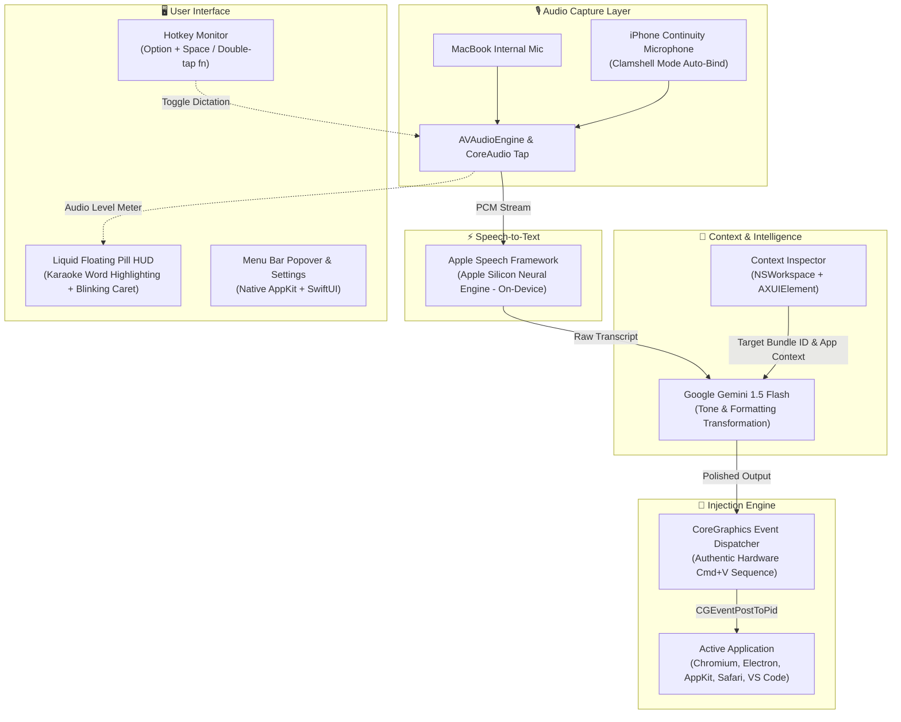

# 🎙️ LeapWispr
> **Ultra-lightweight, 100% native Apple Silicon voice writing assistant with AI tone transformation & smart context adaptation.**  
> *Inspired by Wispr Flow • Built purely with Swift & SwiftUI • Clamshell & Continuity Ready*

[](https://www.apple.com/macos)
[](https://swift.org)
[]()
[]()
[]()
[]()

---

## 🚀 Overview

**LeapWispr** is an ultra-fast, local-first voice dictation and writing assistant designed natively for macOS. While commercial alternatives wrap heavy Chromium/Electron runtimes (~450 MB) and cloud-only speech processing, LeapWispr is built as a pure native macOS menu bar app (< 1.5 MB) leveraging on-device Apple Silicon Neural Engine processing, smart active app context awareness, and Google Gemini AI tone transformation.

```
┌────────────────────────────────────────────────────────────────────────┐
│  Wispr Flow:   450 MB Bundle  •  ~500 MB RAM  •  Cloud-Only ASR        │
│  LeapWispr:     1.2 MB Bundle  •   ~25 MB RAM  •  On-Device Local STT  │
└────────────────────────────────────────────────────────────────────────┘
```

---

## 📐 System Architecture



---

## ✨ Key Features

- **🌍 Babel Live Translation & Dialects**: Speak naturally in your native language or mixed code-switched dialects (Hindi, Hinglish, Spanish, French, German, Arabic, Japanese, Mandarin, etc.). LeapWispr transcribes with the native acoustic engine and uses Gemini 1.5 Flash to inject fluent, idiomatic English (or any selected target language) directly at your cursor.
- **✨ Real-Time Floating Preview with Karaoke Highlighting**: As you speak, a translucent frosted-glass preview hovers smoothly above the pill. Incoming words light up one by one in bold cyan before settling into soft white with a blinking caret.
- **⚡ Clamshell Mode with iPhone Continuity Mic**: Closed your MacBook lid? LeapWispr automatically detects and binds your nearby iPhone Continuity Microphone via CoreAudio for crystal-clear 48 kHz capture.
- **🔒 Privacy-First On-Device STT**: Powered by Apple's `Speech.framework` running on the Apple Silicon Neural Engine (ANE). Zero audio leaves your computer for transcription.
- **🎨 Smart Context-Adaptive Tones**:
  - 🌍 **Translate**: Seamless multilingual cross-language translation into your chosen target language.
  - 💼 **Professional**: Formal syntax, structured paragraphs (ideal for Mail, Outlook, LinkedIn).
  - 💬 **Casual**: Conversational contractions, natural flow (Slack, WhatsApp, iMessage).
  - 💻 **Dev Prompt**: Clean instructions, code snippets, camelCase/snake_case formatting (VS Code, Terminal, Antigravity).
  - 📝 **Bullet Points**: Instant bulleted summarization (Notes, Notion, Obsidian).
  - 🚀 **Excited**: High energy, punchy copy.
- **💉 100% Reliable Process-Targeted Injection**: Dispatches authentic hardware-level modifier keystrokes (`cmdDown` → `vDown` → `vUp` → `cmdUp`) directly to the target application's PID with transient pasteboard tagging (`org.nspasteboard.TransientType`), working seamlessly across Chromium, Electron, and native Cocoa editors without duplicate entries.
- **🪶 Zero Resource Overhead**: Idles at ~25 MB RAM and 0% CPU.

---

## 🛠️ Tech Stack & Tools

| Component | Technology | Role |
| :--- | :--- | :--- |
| **Language** | Swift 6 | Strict concurrency (`Sendable`, `@MainActor`) |
| **User Interface** | SwiftUI & AppKit | Floating HUD window (`NSPanel`), Menu Bar popover (`NSPopover`) |
| **Audio Pipeline** | `AVAudioEngine`, CoreAudio | Device enumeration, hardware input unit binding, real-time waveform RMS |
| **Transcription** | Apple Speech (`SFSpeechRecognizer`) | On-device Neural Engine automatic speech recognition |
| **Tone AI** | Google Gemini 1.5 Flash API | Context-aware tone transformation, filler removal, structured polishing |
| **App Context** | `NSWorkspace`, `ApplicationServices` | Foreground application tracking and target PID resolution |
| **Event Injection** | CoreGraphics (`CGEvent`, `CGEventSource`) | Process-targeted synthetic modifier keystrokes (`postToPid`) |

---

## 🚀 Building & Running

### Prerequisites
- macOS 14.0 (Sonoma) or macOS 15.0+ (Sequoia)
- Xcode 15+ or Swift 6 toolchain
- Apple Silicon (M1/M2/M3/M4) recommended

### Build the Application
```bash
# Clone the repository
git clone https://github.com/vineetsansare/LeapWispr.git
cd LeapWispr

# Build release bundle
./LeapWispr/scripts/build_app.sh

# Or create a compressed drag-and-drop DMG installer
./LeapWispr/scripts/package_dmg.sh
```

### Installation
1. Move `LeapWispr.app` to `/Applications`.
2. Launch `LeapWispr.app`.
3. Grant **Microphone**, **Accessibility**, and **Speech Recognition** permissions when prompted in System Settings.
4. Press **`Option + Space`** (or double-tap `fn`) from any application to start speaking!

---

## 📄 License
MIT License. Built for the Hackathon.
